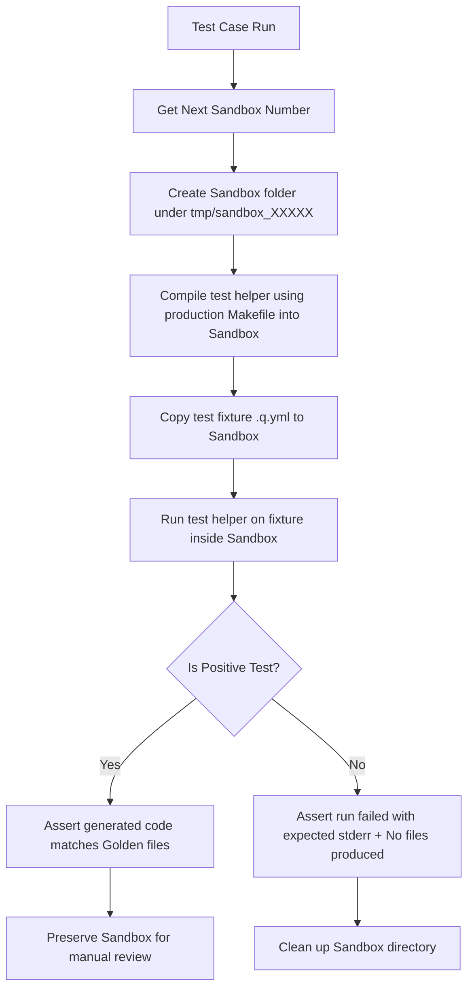

# Working with Quintessence (Development & Testing)

This document outlines the development guidelines, testing standards, and E2E regression-protection architecture for working with and modifying Quintessence parsers and generators in the `blast` codebase.

---

## 1. Development Principles

When refactoring or expanding parsing behavior in the Quintessence tools (e.g. migrating parsing logic from `quintessence_from_yaml.cpp` into standalone C++ component parsers like `Blast::Quintessence::YAMLParsers::QuintessenceParser`):

* **No Boot-Strapping Loops**: Avoid defining standalone parser components using `.q.yml` quintessences themselves. Keep parser components as plain/vanilla C++ files to avoid circular compiler dependencies.
* **Makefile Parity**: Always compile helper/test binaries utilizing the production `Makefile` pipeline to ensure all compiler options, linked libraries, and environment flags match the real production runtime exactly.

---

## 2. E2E Sandbox Testing Architecture

To ensure zero regressions when moving parsing logic, we use a dynamic, sandboxed integration testing architecture defined in `tests/Blast/Quintessence/YAMLParsers/QuintessenceParserTest.cpp`.

### Sandbox Directory Isolation
* Every test case compiles the test binary and executes inside a unique, dynamic, project-local directory (e.g. `tmp/sandbox_00001/`).
* Sandbox directories use a 5-digit zero-padded, self-incrementing naming convention (e.g., `sandbox_00001`, `sandbox_00002`).
* A static in-memory counter is used at test runtime to guarantee that sandbox indexes increment monotonically even if previous sandbox directories were deleted.

### Cleanup Rules
* **Positive Tests**: The sandbox directory is **left intact** on disk for developer review and inspection of generated `.hpp` and `.cpp` files.
* **Negative/Failure Tests**: The sandbox directory is **automatically cleaned up** after verification to avoid bloating the disk with error test logs.

---

## 3. Testing Standards & Coverage

We maintain a high standard of E2E coverage for both successful generation and validation failures.

### Positive/Success Test Cases
* Positive tests execute against fixtures in `tests/fixtures/quintessence/quintessences/`.
* They verify that the generator successfully runs with an exit code of `0`.
* The output header and source files must exactly match static hard-coded golden files in `tests/fixtures/quintessence/goldens/`.
* Goldens must be static, committed files to prevent drift from actual expected compiler outputs (never copied directly at runtime).

### Negative/Validation Failure Test Cases
* Negative tests verify parser error reporting behavior, ensuring the program halts, outputs a proper error code, prints correct logs to stderr, and generates no output files.
* To minimize visual clutter, all negative test fixtures are located in `tests/fixtures/quintessence/quintessences/negative/`.
* Every validation check or `validate()` statement in the YAML parser must have a corresponding test case verifying the exact stderr output.

### Code Style Constraints
* **Line-Width Limit**: To prevent word-wrapping and line-too-long lint errors, all test code (including `QuintessenceParserTest.cpp`) must strictly adhere to a **120-character width limit**. No line may exceed 120 columns.
* **Line Ending Normalization**: Tests must run `normalize_line_endings()` (stripping `\r` carriage returns) before comparing outputs or verifying stderr messages, ensuring cross-platform stability.
* **Dynamic Workspace Resolution**: Never introduce hard-coded developer paths (like `/Users/markoates/`). Always resolve the workspace root dynamically using the `Blast::DeveloperSystem` helper.
